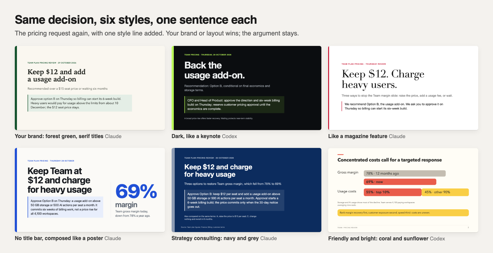

# Super Document Skills

Super Document Skills helps the agent you already use turn your notes into clearer decks, docs, and diagrams. Ask in your own words and tell the agent who will read the result. The skills guide it to put the main point first, check its claims against your notes, and review the draft. If you have a brand guide, give it to the agent. A few words about the look you want work too.

We gave Claude the same notes for a pricing review twice. On its own, Claude opened with a list of options and waited until slide 10 to give a recommendation. With the skill, it opened with what leadership needed to decide. The next slide showed why the recommendation focused on heavy users: the top 10% of workspaces accounted for 55% of usage costs.

The six skills are free and open source. You can open and edit the HTML file on your computer, then use share/artifacts if you want a link you control.

[Find a skill](#start-with-the-job-you-need-done) · [Install](#install) · [See the pricing comparison](https://shareartifacts.dev/#difference)

## Start with the job you need done

The [presentation skill](skills/create-html-presentation/SKILL.md) helps your agent build a deck for a decision, product update, roadmap, talk, or lesson. It puts the point up front and gives each slide a job. The [visual report skill](skills/create-visual-report/SKILL.md) helps turn research, notes, and results into a report with the evidence and caveats close to the finding.

For project work, the [project management skill](skills/create-project-management-artifact/SKILL.md) covers weekly updates, plans, and decision records. It helps show what moved, what is blocked, and who needs to act. If a client needs to choose between options, the [client decision brief skill](skills/create-client-decision-brief/SKILL.md) helps compare them on the same criteria and explain what would change the recommendation.

The [visual explainer skill](skills/create-visual-explainer/SKILL.md) uses concrete examples and diagrams to explain an idea. The [workflow diagram skill](skills/create-workflow-diagram/SKILL.md) helps map a system's main path, supporting steps, and failure paths.

## Examples

These examples use made-up scenarios. The [onboarding pilot deck](examples/README.md#build-a-story-for-a-decision) makes a case for extending a pilot and keeps the limits of the evidence beside the results. The [client decision brief](https://shareartifacts.dev/examples/client-decision-brief) compares costs, exclusions, and timing. The [checkout workflow diagram](examples/README.md#show-how-a-system-works) shows when an order is accepted.

[](docs/decision-deck-results.md)

You can ask your agent for a different look each time. Explore [more deck styles](https://shareartifacts.dev/presentations/gallery) or see [how a saved style carries across formats](https://shareartifacts.dev/styles#styles-in-action).

## Install

To install the presentation skill, run the command for your agent from your project.

For Claude Code

```sh
npx skills add arunai30/super-document-skills --agent claude-code --skill create-html-presentation --copy
```

For Codex

```sh
npx skills add arunai30/super-document-skills --agent codex --skill create-html-presentation --copy
```

To install another skill, replace `create-html-presentation` with its folder name. You can also pass `'*'` to install all six. If you already have a copy, review it before replacing it. Then check that your agent can find the skill.

If your agent supports [Agent Skills](https://agentskills.io/specification), you can also [import the complete skill folder](docs/usage-and-validation.md#install), including its assets, references, and license.

## Try a skill

Give your agent the notes, say who will read the result, and describe what they need to decide or understand. You can also tell it how you want the result to look.

> Use create-visual-report to turn the attached pilot notes into a decision brief
> for our operations lead. Help them decide whether to extend the pilot. Compare
> the options, show the evidence and unknowns, and use a warm editorial style.
> Create a local HTML file. Keep it local for review.

Open the file in a browser and check the facts and layout. If you want to start with sample notes, [try the seat reservation explainer](examples/try-it.md).

## Presentation test results

We gave Claude Code with Claude Opus 5.5 and Codex with GPT-6.1 Sol six briefs for each kind of deck below. Each agent made two decks per brief on its own and two with the skill. Three briefs in each group were held out during tuning. A model reviewer read every slide without knowing which decks used the skill.

The reviewer counted decks that included a statement the source notes did not support. Each column covers 24 decks across Claude and Codex.

| Deck type | Agents on their own | Agents using the skill |
| --- | ---: | ---: |
| [Product decisions](docs/decision-deck-results.md) | 16 of 24 | 5 of 24 |
| [Talks and lessons](docs/talk-deck-results.md) | 16 of 24 | 0 of 24 |
| [Roadmaps](docs/roadmap-results.md) | 17 of 24 | 0 of 24 |
| [Product updates](docs/product-update-results.md) | 16 of 24 | 0 of 24 |

A [separate test on two decision memos](docs/doc-to-deck-results.md) compared versions of the skill. The model reviewer flagged unsupported statements in 8 of 8 decks before the change and 0 of 8 after it.

## Share a link

You can use the skills on your computer without a share/artifacts account. If you want to share your work, connect a compatible agent and ask it to publish. The link starts private. You can open it to anyone, protect it with a password, or limit access to specific people or your organization. You can also set an expiry date and make changes at the same address.

If you save your fonts, colors, and layout preferences in share/artifacts, connected agents with access can reuse them. Readers can open a deck on their phones or present it full screen. Where PDF export is enabled, they can download a copy.

The first five successful publishing actions are free. Each publish, update, or republish counts as one.

[Connect your agent](https://shareartifacts.dev/connect) · [How sharing works](docs/usage-and-validation.md#optional-publishing-with-shareartifacts) · [Publishing plans](https://shareartifacts.dev/pricing)

## Documentation and contributing

The [usage guide](docs/usage-and-validation.md) covers installation, supported formats, and validation. You can also read about [workflow diagrams](docs/diagram-vision.md) or follow the [client decision brief walkthrough](examples/client-decision-brief/README.md).

If something is unclear or you want to suggest another document type, [open an issue](https://github.com/arunai30/super-document-skills/issues).

When reporting a result, include the skill, agent, intended reader, and what was unclear. Use redacted or made-up source notes when sharing an example. Maintainers can run `node --test tests/*.test.mjs` with Node.js 24 or newer.

## License

[MIT](LICENSE). Each skill includes a copy of the license.
