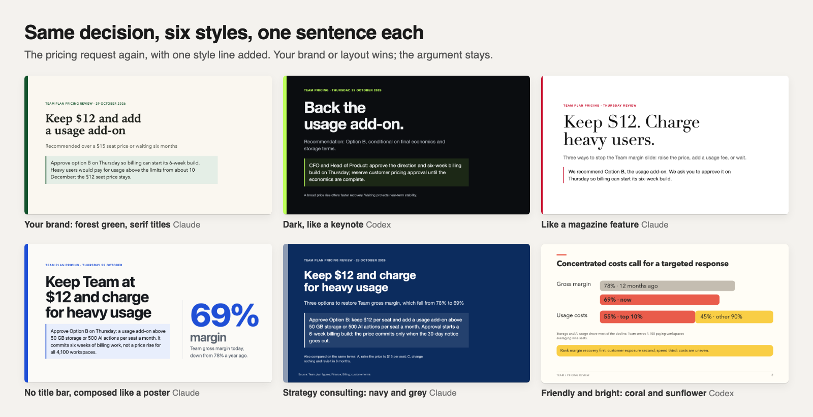
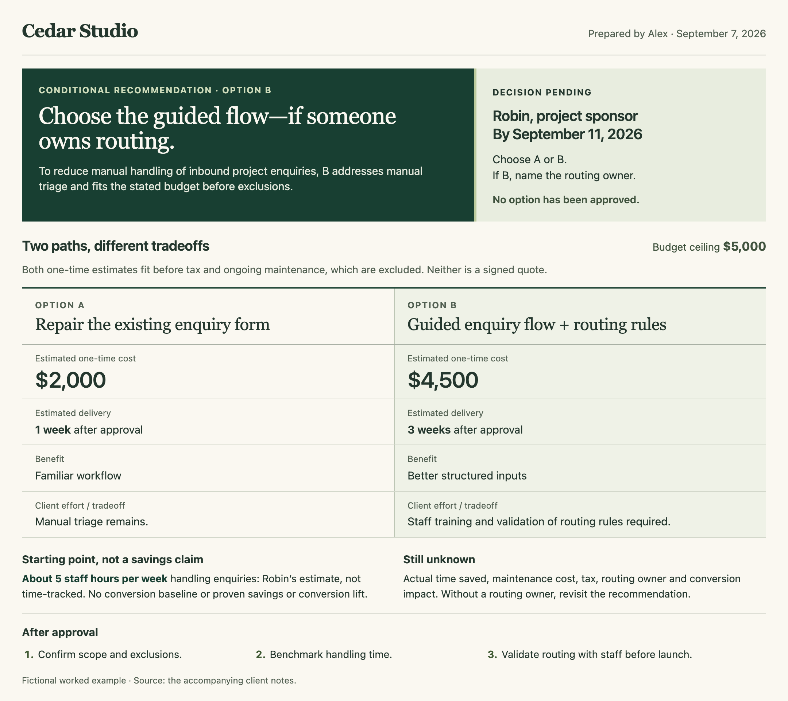
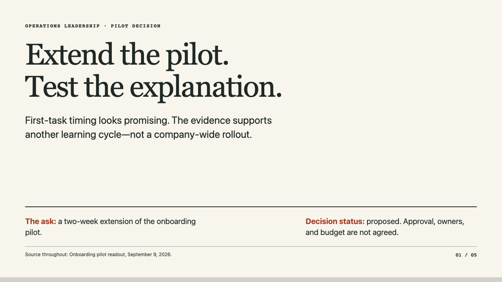
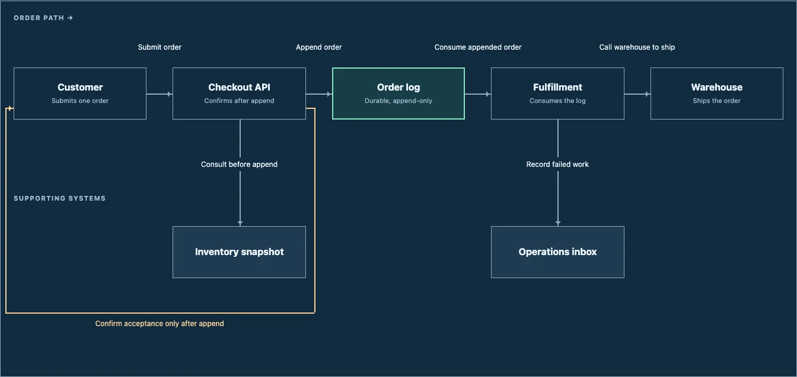

# Super Document Skills

**Turn rough notes into visual reports, presentations, and decision briefs.**

Six free, open-source skills for AI agents. Bring your notes and tell your agent
who the document is for. Get a local HTML document you can open, edit, and share.
No account or publishing connection required.

[See the examples](examples/README.md) · [Install](#install) · [Try a complete sample](examples/try-it.md)

## New: decision decks you'd actually send

Not happy with the decks Claude or Codex make? I gave both agents the same 12 product decisions. A blind
reviewer read every slide and said whether they'd send each deck as it is.

| | Claude Opus 5.5 | Codex (GPT-6.1 Sol) |
| --- | --- | --- |
| On its own: would send | 3 of 12 | 3 of 12 |
| **With this skill: would send** | **9 of 12** | **8 of 12** |

[](docs/decision-deck-results.md)

Across all 24 decks, the skill took invented statements from 16 decks to 5, broken layouts from 11 to 0, and
template-looking decks from 8 to 0. It isn't a longer prompt. It's six small pieces, each fixing one thing
agents get wrong, and the agent stays free everywhere else:

- **A router** picks the method for the job: an executive decision gets the decision recipe, a talk or lesson gets the general one.
- **Argument rules**: the answer and the ask on slide 1, every option (including waiting) with the same numbers, only facts from your notes.
- **A starter layout in CSS**: a fixed frame with the title at the top and a balanced body, like a well-built web page. Lopsided slides went from 54 of 166 to 0.
- **Style as a few settings**, so the agent still draws its own charts for your decision.
- **A checker** that screenshots every slide in your Chrome so the agent fixes its own overflow, stray labels and empty space.
- **Your instructions win**: ask for your brand, your template or your own layout and the agent follows you.

[](docs/decision-deck-results.md)

```sh
# Claude Code
npx skills add arunai30/super-document-skills --agent claude-code --skill create-html-presentation --copy
# Codex
npx skills add arunai30/super-document-skills --agent codex --skill create-html-presentation --copy
```

Then give your agent your notes and the decision you need. [How it was tested, with every number](docs/decision-deck-results.md).

## New: roadmap decks your leadership can agree to

A roadmap deck has one job: get leadership to agree what gets built, in what order, and what that pushes out. I
gave Claude and Codex the same 12 roadmap requests, three of them requests the skill was never tuned on. A blind
reviewer read every slide and said whether they'd send each deck as it is.

| | Claude Opus 5.5 | Codex (GPT-6.1 Sol) |
| --- | --- | --- |
| On its own: would send | 0 of 12 | 2 of 12 |
| **With this skill: would send** | **12 of 12** | **11 of 12** |

What the roadmap recipe fixes:

- **No plans you didn't make.** On their own, every deck added owners, deadlines, checkpoints or "decision needed today". With the skill, dates, estimates and next steps come only from your notes.
- **No recommendation you didn't give.** When the reader has to choose, the options are set out alike.
- **Evidence at its real size.** No "biggest churn driver" for a reason 31% of exit surveys gave.
- **Honest timelines.** Quarters or now / next / later, whichever your leader wants, with confidence falling with distance and real commitments marked.
- **Tradeoffs in the open.** What each order delays and a short "not now" list, on their own slides.
- **Customer roadmaps that are safe to send.** No customer names, revenue, estimates or slips; uncertain items not promised; quarters labelled; no added marketing claims.

[](docs/roadmap-results.md)

Install it with the same commands as the decision deck above; the skill picks the roadmap recipe when you ask for
a roadmap. [How it was tested, with every number](docs/roadmap-results.md).

## New: product updates that don't make things up

Your VP reads your update to see where things stand and what you need. I gave Claude and Codex the same 12 product
updates, three of them requests the skill was never tuned on. A blind reviewer read every slide and said whether
they'd send each deck as it is.

| | Claude Opus 5.5 | Codex (GPT-6.1 Sol) |
| --- | --- | --- |
| On its own: would send | 0 of 12 | 2 of 12 |
| **With this skill: would send** | **12 of 12** | **11 of 12** |

[](docs/product-update-results.md)

On their own, both agents explained numbers the notes couldn't explain and added owners, deadlines and
recommendations nobody made. With the skill, the reviewer flagged invented statements in 0 of 24 decks, against 16
of 24 without it. The recipe puts the state and the ask on slide 1, shows every result against its target, says
"we don't know yet" when that's true, and spends the slides on what missed or moved.

Install it with the same commands as the decision deck above; the skill picks the update recipe when you ask for a regular update.
[How it was tested, with every number](docs/product-update-results.md).

## Six skills for the documents you make

[](https://shareartifacts.dev/examples/client-decision-brief)

*A complete fictional client brief: recommendation, tradeoffs, and the decision needed. [Open the live example](https://shareartifacts.dev/examples/client-decision-brief).*

## Start with the job you need done

| I need to… | Start here | What the skill helps you do |
| --- | --- | --- |
| Turn project notes into a weekly update | [Project-management artifacts](skills/create-project-management-artifact/SKILL.md) | Surface progress, blockers, risks, and the decision needed |
| Make a complex idea understandable | [Visual explainer](skills/create-visual-explainer/SKILL.md) | Carry one concrete example through a meaningful visual |
| Help a client choose between options | [Client decision brief](skills/create-client-decision-brief/SKILL.md) | Compare costs and tradeoffs, then make a conditional recommendation |
| Turn research or results into a decision | [Visual report](skills/create-visual-report/SKILL.md) | Connect evidence, uncertainty, and a useful next step |
| Present an argument or lesson, update leadership, agree a roadmap, or get a product decision approved | [HTML presentation](skills/create-html-presentation/SKILL.md) | Build a story across a paced, browser-readable deck; tested recipes turn product notes into a decision deck, a product update against goals, or a roadmap leadership can agree to |
| Show how a request moves through a system | [Workflow diagram](skills/create-workflow-diagram/SKILL.md) | Lay out a short main path with supporting and feedback paths |

## See what your notes can become

These examples use fictional inputs. They demonstrate possible results, not a
required visual style. Follow each example to its input, exact request, and output.

| From this… | To this… | Explore |
| --- | --- | --- |
| Cohort counts and a stakeholder claim | A growth brief that checks the claim and compares the options | [Report walkthrough](examples/README.md#turn-results-into-a-decision) |
| Six rules about seat reservations | A visual explanation of why two people can see the last seat | [Explainer walkthrough](examples/README.md#make-a-complex-idea-click) |
| Pilot results and incomplete feedback | A five-slide case for a bounded next step | [Presentation walkthrough](examples/README.md#build-a-story-for-a-decision) |

[](examples/README.md#build-a-story-for-a-decision)

*HTML presentations: a complete evidence slide, rather than just the title.*

[](examples/README.md#show-how-a-system-works)

*Workflow diagrams: named steps and labeled connections in a blueprint style.*

[Explore all six visual examples](examples/README.md), including report charts,
a worked timeline, and a weekly update. Styles are examples, not fixed templates.

## Install

For Codex, run this from your project to install the visual explainer used in
[the complete starter example](examples/try-it.md):

```sh
npx skills add arunai30/super-document-skills --agent codex --skill create-visual-explainer --copy
```

Or install all six:

```sh
npx skills add arunai30/super-document-skills --agent codex --skill '*' --copy
```

Review an existing copy before replacing it. Confirm the skill appears in your
client's skill selector or discovery list before using it.

**Using another agent?** These are portable [Agent Skills](https://agentskills.io/specification).
Use your client's supported import flow to import a complete folder from
[skills](skills), including its assets, references, and license. Client support
varies; see [manual installation and compatibility notes](docs/usage-and-validation.md#install).
A clone or ZIP download alone does not activate the skills.

## Try it with everything supplied

Start with [Why can two customers see the last seat?](examples/try-it.md)
The sample includes the complete prompt and source material, a reference output,
and a short checklist for reviewing your result.

For your own work, give the installed skill four things:

> Use create-visual-report to turn the attached pilot notes into a decision brief
> for our operations lead. Help them decide whether to extend the pilot. Compare
> the options, show the evidence and unknowns, and use a warm editorial style.
> Create a local HTML file; do not publish it.

**Your material · Your reader · The decision or takeaway · Your visual direction.**

The default output is local HTML. Several skills can honor a requested different
format when suitable tools are available; the presentation skill specifically
creates HTML decks. Open the result in a browser and review its facts and appearance
before sharing. See [format and review guidance](docs/usage-and-validation.md#use).

## Why use a skill?

Each skill gives your agent a repeatable method for choosing the story, preserving
the evidence, designing useful visuals, and checking the result. You can change
the visual direction without having to rewrite that method for every document.
The [source notes and outputs](examples/README.md) make that method inspectable.

## Want a shareable link?

After reviewing your document, you can optionally publish it with
[share/artifacts](https://shareartifacts.dev) through an already-connected compatible
MCP client. Publishing is a separate action you request; new publications default
to owner-only access. You keep the local file whether or not you publish.
[Connection instructions](https://shareartifacts.dev/connect) · [Publishing details](docs/usage-and-validation.md#optional-publishing-with-shareartifacts)

## Documentation and contributing

- [Usage, compatibility, and validation](docs/usage-and-validation.md)
- [Diagram vision and supported scope](docs/diagram-vision.md)
- [Client decision brief guide](examples/client-decision-brief/README.md)
- [Report a problem or request a document type](https://github.com/arunai30/super-document-skills/issues)

When reporting a result, include the skill, agent client, intended reader, and what
was unclear. Use redacted or fictional source material when sharing an example.
Maintainers can run `node --test tests/*.test.mjs` with Node.js 24 or newer.

## License

[MIT](LICENSE). Each skill includes its own license copy.
